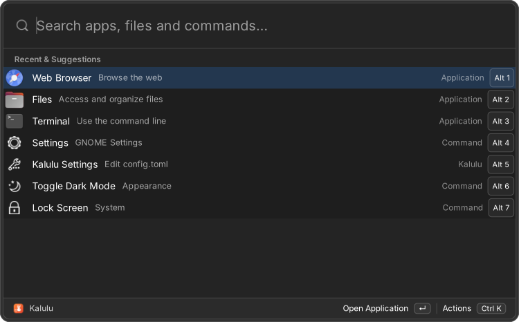
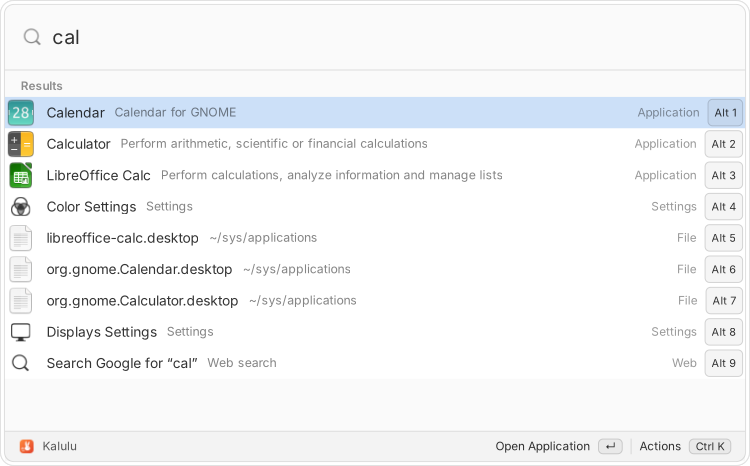
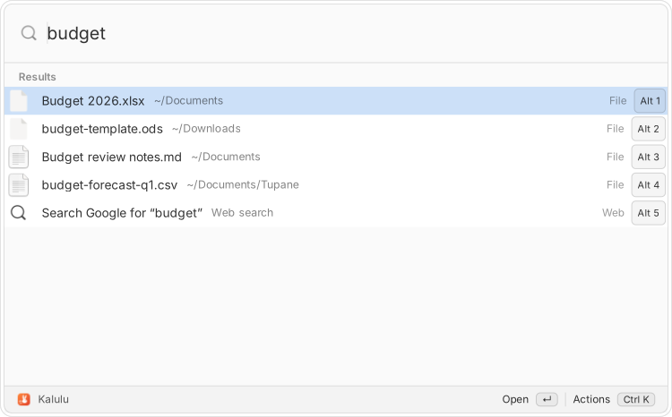
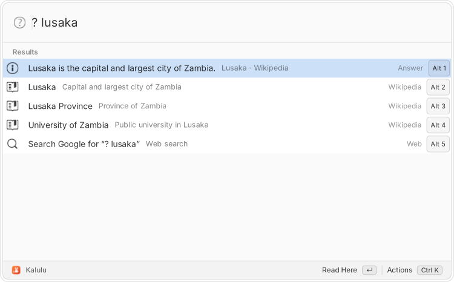
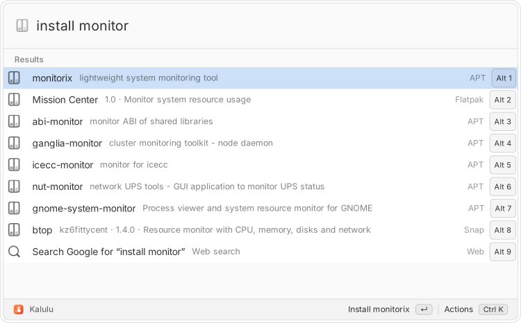
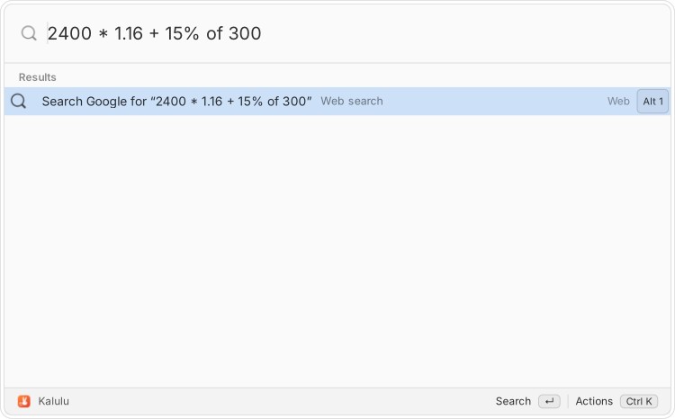
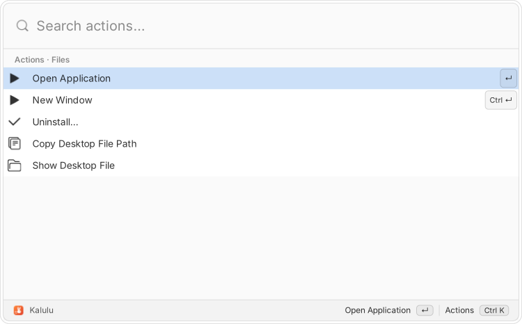
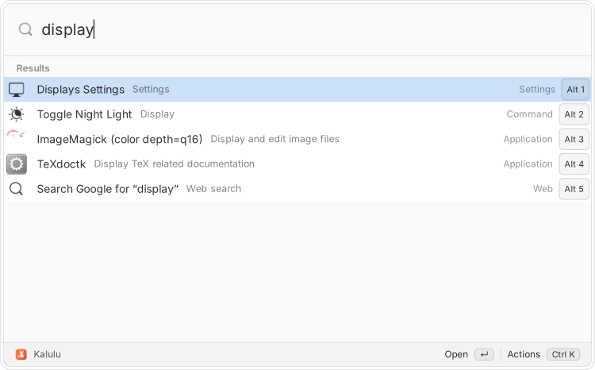
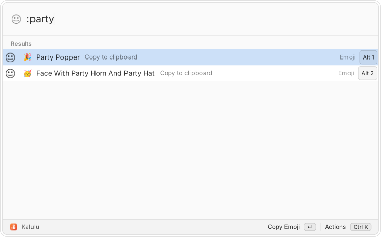

# Kalulu

A Raycast-style launcher for GNOME on Ubuntu 26.04 LTS. Native GTK4 + libadwaita, pure Python, no Electron.
It stays resident in the background, so the hotkey opens it instantly. Apps, files, answers, commands
and software installs all happen in one window, without opening a browser.

<p align="center">
  
  
</p>

## Install

```bash
git clone https://github.com/dbwitso/kalulu && cd kalulu
./install.sh                                   # hotkey: Super+Space
KALULU_HOTKEY='<Control>space' ./install.sh    # or any other binding
```

What the installer does (all per-user, `sudo` only for apt deps if missing):

- installs `python3-gi gir1.2-gtk-4.0 gir1.2-adw-1` if they're not already there
- copies the app to `~/.local/share/kalulu`, adds `kalulu` and `kalulu-toggle` to `~/.local/bin`
- adds an app entry, an icon, and an autostart entry (`kalulu --background` at login)
- registers a GNOME custom shortcut that runs `kalulu-toggle`
- **Super+Space:** GNOME uses this by default to switch keyboard layouts. The installer removes just that one
  binding (layout switching stays on the XF86Keyboard key), saves the old value, and `uninstall.sh` restores it.
  If you switch keyboard layouts often, install with another hotkey instead.

Optional extras: `sudo apt install fd-find libnotify-bin wl-clipboard` for faster file search outside GNOME's
indexed folders, notifications, and the public-IP example script.

Update: `git pull && ./install.sh`. Uninstall: `./uninstall.sh` (keeps `~/.config/kalulu`) or `./uninstall.sh --purge`.

## What you can do

### Find files, including what's inside documents

Type part of a file name and the best matches appear below your apps. Kalulu searches GNOME's own file index
(the one Activities search uses), so it's instant and also matches text inside documents. It tops up from
`fd`/`plocate` for folders GNOME doesn't index. Use `f name` for a full file list, and `~/` or `/etc/` to browse
folders.



### Get answers without a browser

Wikipedia matches appear under your local results as you type. `? anything` gives a focused answer view and
`define word` gives dictionary definitions. ↵ reads the summary inside Kalulu, and Ctrl+↵ opens it in the browser
only if you want more.

<p align="center">
  
  
</p>

### Install and remove software

`install <name>` searches **APT, Snap and Flatpak** at once. Press ↵ to install in the background: GNOME asks for
your password, and a notification tells you when it's done. Ctrl+↵ installs in a terminal so you can watch, and
Ctrl+K → Show Details shows package info. `uninstall <app>` (or Ctrl+K → Uninstall… on any app) works out
whether it came from apt, snap or flatpak and removes it from there. **Update All Software** runs apt, snap and
flatpak updates in one go.



### Everything else

<p align="center">
  
  
</p>
<p align="center">
  
  
</p>

| Type | Gets you |
|---|---|
| `cal`, `vsc`, `term` | Apps (fuzzy matching and acronyms; learns your picks, so `f` → Firefox after a few uses) |
| `budget`, `f budget`, `~/Documents/` | Files: blended results, full search, folder browsing |
| `? lusaka`, `define kalulu`, or just type | Answers, definitions and Wikipedia, shown inside Kalulu |
| `install btop`, `uninstall gimp` | Install or remove software (APT, Snap, Flatpak) |
| `2400 * 1.16`, `15% of 2400`, `2^32`, `0xff + 1` | Calculator, ↵ copies the answer |
| `bluetooth`, `display`, `sound`, `wifi` | Jump straight to a GNOME Settings page |
| `lock`, `sleep`, `dark`, `dnd`, `night`, `trash`, `restart`, `upgrade` | System commands (destructive ones ask for a second ↵) |
| `> docker ps` | Shell: ↵ runs it in a terminal, Ctrl+↵ shows the output inside Kalulu |
| `:party` | Emoji picker (copies) |
| `gh kalulu`, `yt …`, `maps …`, `pkg …` | Quicklinks (edit them in config) |
| `github.com/dbwitso` | Opens the URL |
| `kill chrome` | Process killer (example plugin) |
| anything else | Web search fallback, always last |

**Keys:** ↑↓ / Ctrl+N/P move · ↵ run · Ctrl+↵ second action · **Ctrl+K action panel** · Alt+1…9 pick a row ·
Tab completes · Esc goes back / clears / hides · Ctrl+, settings · Ctrl+R reload.

CLI: `kalulu` (toggle) · `--show` · `--hide` · `--query ':'` (open prefilled, e.g. bind a second hotkey to
the emoji picker) · `--reload` · `--doctor` (lists apps whose icons can't be found) · `--quit`.

## Script Commands

Put any executable in `~/.config/kalulu/scripts/` and it becomes a command (run **Reload Kalulu** or press Ctrl+R):

```bash
#!/usr/bin/env bash
# @kalulu.title Restart NetBird
# @kalulu.subtitle Networking
# @kalulu.mode compact          # silent (notification) | compact (footer toast) | fullOutput (in launcher) | terminal
# @kalulu.icon network-vpn-symbolic   # icon name, image path next to the script, or an emoji
# @kalulu.keywords vpn wireguard
# @kalulu.argument1 {"placeholder": "peer"}   # optional; type "Restart NetBird <arg>". Separate multiple args with |
# @kalulu.needsConfirmation true
sudo -n systemctl restart netbird && echo "NetBird restarted"
```

Any language works (Python, Node, …). The `@raycast.` prefix is accepted too, so many existing Raycast script
commands run unchanged (the macOS-only ones won't, obviously). Examples installed: NetBird status, Docker containers,
top memory users, kill port, copy public IP.

## Plugins

For anything dynamic, drop a Python file in `~/.config/kalulu/plugins/`:

```python
NAME = "Hello"
PREFIX = "hi "        # optional: only runs when the query starts with this
SLOW = False          # True runs it off the UI thread (for network calls)

def search(query, api):
    return [api.Result(id="hello", title=f"Hello {query}", icon="face-smile-symbolic",
                       actions=[api.Action("Copy", "copy", f"Hello {query}"),
                                api.Action("Open site", "open_uri", "https://example.com")])]
```

Action kinds: `copy`, `open_uri`, `run` (argv list, detached), `terminal` (shell string), `callback`
(Python function; return a string for a toast, or `("detail", text_or_dict)` to show it in the launcher),
`script`, `reveal`, `complete` (rewrites the query), `detail`. Set `confirm=True` for dangerous actions.
See `examples/plugins/processes.py`.

## Config

`~/.config/kalulu/config.toml` (open it with **Kalulu Settings** or Ctrl+,): result count, hide on focus loss,
preferred terminal, web search engine, inline answers on/off and language, package sources, file search roots,
quicklinks.

## Privacy

Apps, files, commands, the calculator and settings are all local. Inline answers send your query to Wikipedia
(as you type, after a short pause, 3+ characters), to DuckDuckGo (only in `?` mode) and to dictionaryapi.dev
(only for `define`). Turn this off with `inline_answers = false` under `[web]`. `install` uses your package
managers, which contact their own repositories.

## How it fits GNOME/Wayland

- Wayland doesn't let apps grab global hotkeys, so the hotkey is a GNOME custom shortcut. It calls
  `kalulu-toggle`, which sends a single D-Bus `Activate` to the running instance (~30 ms) and forwards the
  activation token so Mutter gives the window focus.
- Single instance via `GApplication`. Apps launch through `Gio.DesktopAppInfo`, so you get proper startup
  notification, and desktop actions like "New Window" show up in the action panel.
- Reads `.desktop` files from apt, snap, flatpak and `~/.local` directly, refreshing when those folders change.
  Icons are resolved the way GNOME Shell does it (pixmaps, file paths, Flatpak/Snap icon folders).
- File search talks to LocalSearch (GNOME 47+) or Tracker 3 over D-Bus. Slow sources (files, answers, packages)
  each run in their own thread and stream into the list, so a slow network never blocks local results.
- Installs use polkit (`pkexec`, snapd, flatpak), so authentication is the normal GNOME password dialog.
- Frecency lives in `~/.local/state/kalulu/frecency.json`, and logs in `kalulu.log` in the same folder.

## Not yet (good next steps)

Clipboard history and window switching (GNOME doesn't let normal Wayland apps watch the clipboard or list
windows; both need a small Shell extension), snippets/text expansion, a settings GUI.

## Dev

```bash
python3 tests/test_core.py                               # engine tests, no display needed
PYTHONPATH=. python3 -m kalulu --show
xvfb-run -a dbus-run-session python3 tests/screenshots.py docs/screenshots   # regenerate screenshots
KALULU_DARK=1 xvfb-run -a dbus-run-session python3 tests/screenshots.py docs/screenshots
```
